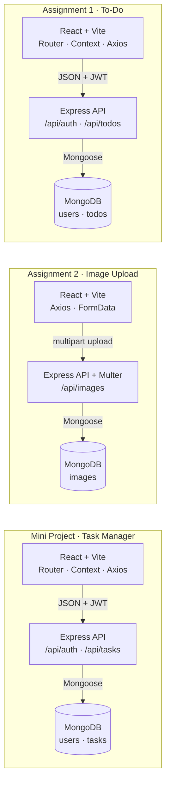
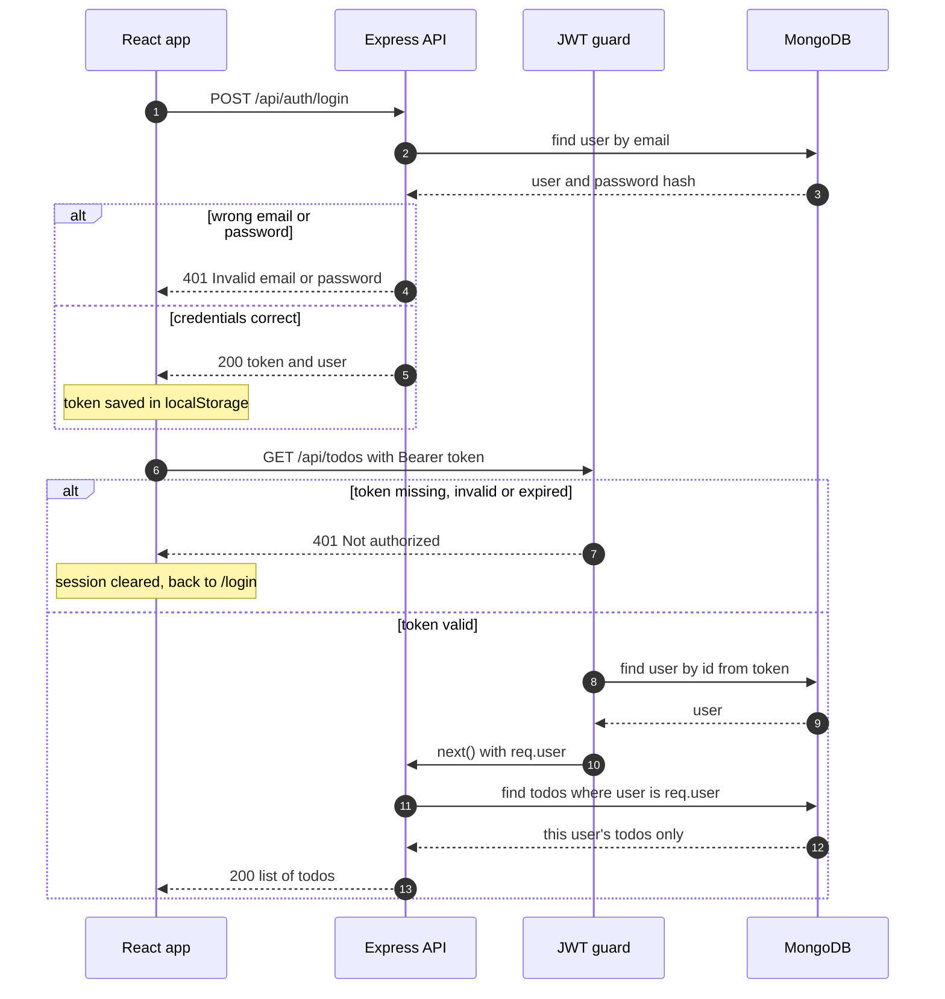
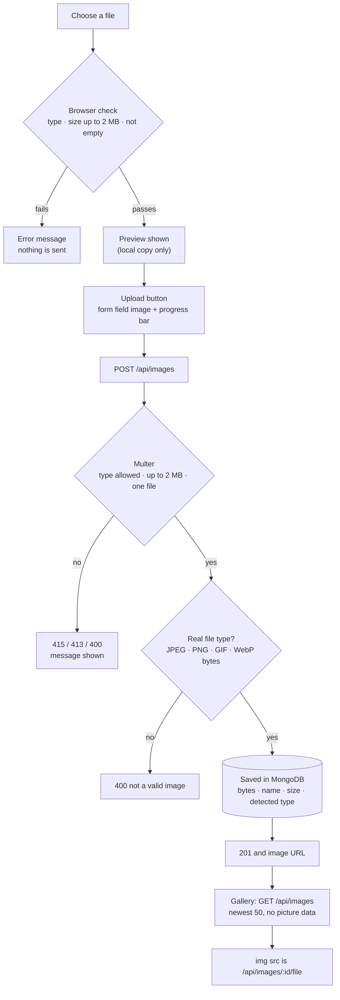
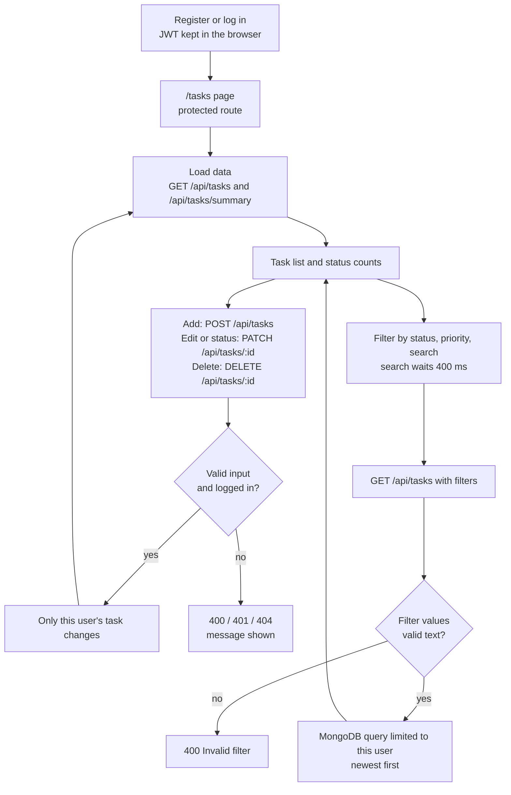

<div align="center">

<h1>🚀 Skill Nexis Week 3</h1>
<h3>Full Stack Integration Projects</h3>

<p><em>Connecting React frontends to Express APIs and MongoDB:<br/>two assignments and one mini project.</em></p>

<p>
  <a href="https://react.dev"></a>
  <a href="https://vitejs.dev"></a>
  <a href="https://reactrouter.com"></a>
  <a href="https://axios-http.com"></a>
  <a href="https://nodejs.org"></a>
  <a href="https://expressjs.com"></a>
  <a href="https://www.mongodb.com"></a>
  <a href="https://mongoosejs.com"></a>
  <a href="https://jwt.io"></a>
  <a href="https://github.com/expressjs/multer"></a>
</p>

<p>
  
  
  
</p>

<p><strong>Skill Nexis Full Stack Web Development (MERN) Internship · Week 3</strong></p>

</div>

---

<a id="table-of-contents"></a>

## 📑 Table of Contents

1. [Overview](#overview)
2. [Portfolio Highlights](#portfolio-highlights)
3. [Project Comparison](#project-comparison)
4. [Technology Stack](#technology-stack)
5. [Repository Structure](#repository-structure)
6. [Architecture](#architecture)
7. [Assignment 1: Full Stack To-Do](#assignment-1)
8. [Assignment 2: Image Upload](#assignment-2)
9. [Mini Project: Task Manager](#mini-project)
10. [API Documentation](#api-documentation)
11. [Authentication and Security](#authentication-and-security)
12. [Environment Variables](#environment-variables)
13. [Installation and Setup](#installation-and-setup)
14. [Running the Projects](#running-the-projects)
15. [Testing and Verification](#testing-and-verification)
16. [Learning Outcomes](#learning-outcomes)
17. [Known Limitations](#known-limitations)
18. [Deployment Status](#deployment-status)
19. [Conclusion and Acknowledgment](#conclusion)

---

<a id="overview"></a>

## 🔎 Overview

Week 3 of my Skill Nexis internship was about **full stack integration**: making a React frontend talk to an Express backend that stores its data in MongoDB. This repository holds my three Week 3 deliverables. Each one is a separate, self-contained project with its own backend, frontend, tests and README.

> [!IMPORTANT]
> **Verification status in one sentence:** all three projects are written and pass automated tests that run **offline or with mocks**, but they have **not yet** been installed with `npm install`, built with Vite, connected to a real MongoDB database, tested in a browser, or deployed. Nothing in this README claims more than that. See [Testing and Verification](#testing-and-verification).

### Portfolio at a glance

| Project | Type | Purpose | Core features | Main technologies | Verification |
|---|---|---|---|---|---|
| [**Full Stack To-Do**](Assignment-1-Full-Stack-To-Do/README.md) | Assignment 1 | A personal to-do list with login | Register, login, protected page, to-do CRUD, per-user data | React, Router, Express, Mongoose, JWT | Offline and mock tests only |
| [**Image Upload**](Assignment-2-Image-Upload/README.md) | Assignment 2 | Upload, preview and display images | Multer upload, preview, gallery, file-type checks | React, Express, Multer, Mongoose | Offline and mock tests only |
| [**Task Manager**](Mini-Project-Task-Manager/README.md) | Mini Project | Track tasks and filter them | Login, status and priority, filters, search, counts | React, Router, Express, Mongoose, JWT | Offline and mock tests only |

### What the official brief asks for

From the Week 3 assignment sheet (`week_3.pdf`):

| Project | Official requirement |
|---|---|
| Assignment 1 | Connect the Week 2 API with a React frontend. Implement authentication, CRUD functionality, and routing. |
| Assignment 2 | Create a file upload endpoint using Multer. Integrate with React to preview and display uploaded images. |
| Mini Project | A complete task tracking web app with user login and task filtering. Frontend in React, backend in Express, and MongoDB for storage. |

The sheet also lists these topics: connecting React with Express, Axios or Fetch, React Router and protected routes, Context API or Redux, form validation, and file upload with Multer.

**Official requirement versus my decision.** The brief does not say what "filtering" means, whether the upload project needs a login, or where uploaded images should be stored. Those choices are my own **implementation decisions**, and each project section below labels them clearly.

---

<a id="portfolio-highlights"></a>

## ✨ Portfolio Highlights

- **Three self-contained full stack projects** (React, Express, MongoDB), each with its own README, environment example and tests.
- **125 automated tests**: 79 plain-code tests and 46 mock or simulated tests. All pass offline.
- **Login built on my Week 2 work**: the To-Do backend combines my Week 2 To-Do API with my Week 2 authentication code, and the Task Manager reuses that same login code.
- **Per-user data**: every to-do and task query is limited to the logged-in user, and the owner cannot be set from the client.
- **Safer uploads**: the upload endpoint reads the file's real bytes to decide whether it is an image, instead of trusting the file name or the type the browser reports.
- **Careful filtering**: the Task Manager accepts only plain-text filter values (which blocks injected database operators) and escapes search text.
- **Final audit**: a last review of all three projects found and fixed a dependency problem (Multer 1.x is deprecated with known vulnerabilities, so Assignment 2 now declares Multer 2.x). Details are in [`AUDIT-REPORT.md`](AUDIT-REPORT.md).

---

<a id="project-comparison"></a>

## 🧭 Project Comparison

| | Assignment 1: To-Do | Assignment 2: Image Upload | Mini Project: Task Manager |
|---|---|---|---|
| **Login and JWT** | ✅ | — | ✅ |
| **React Router** | ✅ | — (single page) | ✅ |
| **Context API** | ✅ | — | ✅ |
| **Data belongs to a user** | ✅ | — (public, no login) | ✅ |
| **Mongoose models** | `User`, `Todo` | `Image` | `User`, `Task` |
| **API prefixes** | `/api/auth`, `/api/todos` | `/api/images` | `/api/auth`, `/api/tasks` |
| **Standout feature** | CRUD behind a protected route | Multer, real-type detection, preview | Status, priority, filters, counts |
| **Automated tests** | 30 backend | 33 backend + 9 frontend | 44 backend + 9 frontend |
| **`vercel.json` included** | ✅ | — | ✅ |

---

<a id="technology-stack"></a>

## 🧰 Technology Stack

Versions are the ranges declared in each project's `package.json`.

| Technology | Version | Assignment 1 | Assignment 2 | Mini Project |
|---|---|:---:|:---:|:---:|
| React / React DOM | ^18.3.1 | ✅ | ✅ | ✅ |
| Vite (+ `@vitejs/plugin-react`) | ^5.4.8 (+ ^4.3.1) | ✅ | ✅ | ✅ |
| Axios | ^1.7.7 | ✅ | ✅ | ✅ |
| React Router DOM | ^6.26.2 | ✅ | — | ✅ |
| React Context API (built into React) | n/a | ✅ | — | ✅ |
| Node.js | >= 18 | ✅ | ✅ | ✅ |
| Express | ^4.21.0 | ✅ | ✅ | ✅ |
| Mongoose / MongoDB | ^8.5.0 | ✅ | ✅ | ✅ |
| bcrypt | ^5.1.1 | ✅ | — | ✅ |
| jsonwebtoken | ^9.0.2 | ✅ | — | ✅ |
| Multer | ^2.3.0 | — | ✅ | — |
| cors, dotenv | ^2.8.5, ^16.4.5 | ✅ | ✅ | ✅ |
| nodemon (development only) | ^3.1.0 | ✅ | ✅ | ✅ |
| Node's built-in test runner (`node --test`) | n/a | ✅ | ✅ | ✅ |

---

<a id="repository-structure"></a>

## 🗂️ Repository Structure

This is the real structure of the combined package (145 files). The repository holds the **extracted project folders**. Upload the *contents* of the combined ZIP, not the ZIP file itself.

```text
Skill-Nexis-Week-3/
├── README.md   ← this file
├── AUDIT-REPORT.md   ← requirements, tests, findings, fingerprints
├── .gitignore
├── Assignment-1-Full-Stack-To-Do/
│   ├── .env.example, .gitignore, README.md
│   ├── backend/
│   │   ├── .env.example, .gitignore, package.json, server.js
│   │   ├── src/
│   │   │   ├── app.js
│   │   │   ├── config/   checkEnv.js, cors.js, db.js
│   │   │   ├── controllers/   authController.js, todoController.js
│   │   │   ├── middleware/   asyncHandler.js, authMiddleware.js, errorHandler.js, validateAuth.js, validateTodo.js
│   │   │   ├── models/   Todo.js, User.js
│   │   │   ├── routes/   authRoutes.js, todoRoutes.js
│   │   │   └── utils/   generateToken.js
│   │   └── tests/   cors.test.js, security.test.js, todoController.scoping.test.js, validation.test.js
│   └── frontend/
│       ├── .env.example, .gitignore, index.html, package.json, vercel.json, vite.config.js
│       └── src/
│           ├── App.jsx, main.jsx, styles.css
│           ├── api/   client.js
│           ├── components/   Navbar.jsx, ProtectedRoute.jsx, TodoForm.jsx, TodoItem.jsx
│           ├── context/   AuthContext.jsx
│           └── pages/   Login.jsx, NotFound.jsx, Register.jsx, Todos.jsx
├── Assignment-2-Image-Upload/
│   ├── .env.example, .gitignore, README.md
│   ├── backend/
│   │   ├── .env.example, .gitignore, package.json, server.js
│   │   ├── src/
│   │   │   ├── app.js
│   │   │   ├── config/   cors.js, db.js, upload.js
│   │   │   ├── controllers/   imageController.js
│   │   │   ├── middleware/   asyncHandler.js, errorHandler.js, uploadImage.js, validateObjectId.js
│   │   │   ├── models/   Image.js
│   │   │   ├── routes/   imageRoutes.js
│   │   │   └── utils/   imageSignature.js, sanitizeFilename.js
│   │   └── tests/   cors.test.js, fixtures.js, imageApi.mock.test.js, imageSignature.test.js, uploadRules.test.js
│   └── frontend/
│       ├── .env.example, .gitignore, index.html, package.json, vite.config.js
│       ├── src/
│       │   ├── App.jsx, main.jsx, styles.css
│       │   ├── api/   client.js
│       │   ├── components/   ImageGallery.jsx, UploadForm.jsx
│       │   └── utils/   format.js, urls.js, validateFile.js
│       └── tests/   utils.test.js, validateFile.test.js
└── Mini-Project-Task-Manager/
    ├── .env.example, .gitignore, README.md
    ├── backend/
    │   ├── .env.example, .gitignore, package.json, server.js
    │   ├── src/
    │   │   ├── app.js
    │   │   ├── config/   checkEnv.js, cors.js, db.js, taskOptions.js
    │   │   ├── controllers/   authController.js, taskController.js
    │   │   ├── middleware/   asyncHandler.js, authMiddleware.js, errorHandler.js, validateAuth.js, validateTask.js
    │   │   ├── models/   Task.js, User.js
    │   │   ├── routes/   authRoutes.js, taskRoutes.js
    │   │   └── utils/   generateToken.js, taskFilter.js
    │   └── tests/   fixtures.js, taskApi.mock.test.js, taskFilter.test.js, validation.test.js
    └── frontend/
        ├── .env.example, .gitignore, index.html, package.json, vercel.json, vite.config.js
        ├── src/
        │   ├── App.jsx, main.jsx, styles.css
        │   ├── api/   client.js
        │   ├── components/   FilterBar.jsx, Navbar.jsx, ProtectedRoute.jsx, SummaryBar.jsx, TaskForm.jsx, TaskItem.jsx
        │   ├── context/   AuthContext.jsx
        │   ├── pages/   Login.jsx, NotFound.jsx, Register.jsx, Tasks.jsx
        │   └── utils/   filters.js, taskForm.js, taskOptions.js, urls.js
        └── tests/   helpers.test.js
```

Every project folder is independent: it has its own `package.json` files, `.env.example` files and README, and no project imports code from another. Inside each project, the file named `.env.example` at the project root only explains the two real `.env` files. The real ones go in `backend/` and `frontend/`.

---

<a id="architecture"></a>

## 🏗️ Architecture

Each project has its own React app, its own Express API and its own MongoDB database. The three projects do not talk to each other. (The invisible links in the diagram only stack the three groups vertically.)



**How the layers cooperate**

| Layer | What it does |
|---|---|
| React app | Screens, form checks, and one API module per project (`src/api/client.js`) that calls the backend through Axios |
| Express API | Routes, validation, login checks, and error responses as JSON |
| Mongoose and MongoDB | Models and storage. The connection string comes from `MONGODB_URI` |

---

<a id="assignment-1"></a>

## ✅ Assignment 1: Full Stack To-Do

📁 Folder: [`Assignment-1-Full-Stack-To-Do/`](Assignment-1-Full-Stack-To-Do/README.md)

**The problem it addresses.** People need a private place to track what they have to do. This project turns the Week 2 To-Do API into a full stack web application where each person logs in and sees only their own list.

**Official requirement:** connect the Week 2 API with a React frontend, with authentication, CRUD and routing.

### Implemented features (present in the source code; not yet run against real services)

| Feature | What it does | Main files |
|---|---|---|
| Register and login | Name, email and password. Passwords are hashed with bcrypt; login returns a JWT | `backend/src/controllers/authController.js` |
| Protected route | Visitors who are not logged in are sent to `/login` | `frontend/src/components/ProtectedRoute.jsx` |
| To-do CRUD | Create, list (newest first), edit, tick done or not done, delete (with a confirmation question) | `frontend/src/pages/Todos.jsx`, `TodoItem.jsx` |
| Per-user data | Every query is filtered by the logged-in user, and the owner cannot be set by the client | `backend/src/controllers/todoController.js` |
| Form validation | In the browser and on the server: title required (max 100), details optional (max 500) | `TodoForm.jsx`, `backend/src/middleware/validateTodo.js` |
| Clear screen states | Loading, empty list, error and success messages | `frontend/src/pages/Todos.jsx` |
| API layer | One Axios client adds the token automatically; a rejected token logs the user out | `frontend/src/api/client.js` |
| Shared login state | React Context API | `frontend/src/context/AuthContext.jsx` |
| Persistent storage | MongoDB through Mongoose (`User` and `Todo` models); not yet connected to a real database | `backend/src/models/` |

**Frontend routes:** `/` redirects to `/todos` · `/login` · `/register` · `/todos` (protected) · any other path shows a "page not found" screen.

**Implementation decisions (not in the brief):** the Week 2 To-Do API had no login, so I added my Week 2 authentication code to a *copy* of it (the Week 2 originals were left untouched). Each to-do has an owner. The login token is kept in the browser's `localStorage`. Registering does not log the user in automatically.

### Request flow



---

<a id="assignment-2"></a>

## 🖼️ Assignment 2: Image Upload

📁 Folder: [`Assignment-2-Image-Upload/`](Assignment-2-Image-Upload/README.md)

**The problem it addresses.** Many applications need user-supplied pictures. This project shows the full path of one image: choosing it, previewing it, sending it to a server, checking it, saving it and showing it again.

**Official requirement:** create a file upload endpoint with Multer, and integrate it with React to preview and display uploaded images.

### Implemented features (present in the source code; not yet run against real services)

| Feature | What it does | Main files |
|---|---|---|
| Image selection and checks | Browser checks the type (JPEG, PNG, GIF, WebP), size (max 2 MB) and that the file is not empty | `frontend/src/utils/validateFile.js` |
| Preview before upload | The chosen image is shown from a temporary local address; nothing is sent yet | `frontend/src/components/UploadForm.jsx` |
| Upload with progress | Sends the file as form data in the field `image` and shows a progress bar | `frontend/src/api/client.js` |
| Upload endpoint | `POST /api/images` using Multer with memory storage, a 2 MB limit and one file per request | `backend/src/middleware/uploadImage.js` |
| Real-type check | The first bytes of the file must match a JPEG, PNG, GIF or WebP; the *detected* type is what gets stored | `backend/src/utils/imageSignature.js` |
| Database-backed storage | The picture bytes and details are saved in MongoDB (`Image` model) | `backend/src/models/Image.js` |
| Gallery | Lists the newest 50 images without loading picture data; each tile shows a fallback if an image fails to load | `frontend/src/components/ImageGallery.jsx` |
| Serving a picture | `GET /api/images/:id/file` sends the stored type, `X-Content-Type-Options: nosniff` and a cache header | `backend/src/controllers/imageController.js` |

**Where images are stored:** in **MongoDB** (as binary data), not in a folder on the server. File names are cleaned and are only ever shown as plain text.

**Implementation decisions (not in the brief):** images are stored in MongoDB because free hosting services usually erase files saved on the server when it restarts. This reasoning has not been tested on a real host. The project has **no login**, because the brief does not ask for one. SVG files are refused because they can contain scripts.

> [!NOTE]
> These checks reduce risk, but I do not claim the upload is secure against every possible attack. There is no malware scan, no re-encoding of images, no rate limiting and no login.

### Upload flow



---

<a id="mini-project"></a>

## 📋 Mini Project: Task Manager

📁 Folder: [`Mini-Project-Task-Manager/`](Mini-Project-Task-Manager/README.md)

**The problem it addresses.** A plain to-do list becomes hard to use once it grows. The Task Manager adds a status and a priority to every task, and lets the user filter and search, so they can quickly see what is urgent or still open.

**Official requirement:** a complete task tracking web app with user login and task filtering; React frontend, Express backend, MongoDB storage.

### Implemented features (present in the source code; not yet run against real services)

| Feature | What it does | Main files |
|---|---|---|
| Register and login | Same login code as Assignment 1 (bcrypt and JWT) | `backend/src/controllers/authController.js` |
| Protected route | `/tasks` is only available when logged in | `frontend/src/App.jsx`, `ProtectedRoute.jsx` |
| Task management | Create, edit, delete; title (max 100), details (max 500) | `frontend/src/pages/Tasks.jsx`, `TaskForm.jsx` |
| Task status | `todo`, `in-progress` or `done`, changeable with a dropdown on each task | `TaskItem.jsx`, `backend/src/models/Task.js` |
| Task priority | `low`, `medium` or `high`, shown as a colored badge | `TaskItem.jsx` |
| Filtering | By status, by priority, or both | `backend/src/utils/taskFilter.js`, `FilterBar.jsx` |
| Search | Case-insensitive search in title and details; the browser waits 400 ms after typing | `FilterBar.jsx`, `Tasks.jsx` |
| Summary counts | Number of tasks per status and in total (counts ignore the filters) | `backend/src/controllers/taskController.js`, `SummaryBar.jsx` |
| Per-user data | Every query is limited to the logged-in user | `backend/src/controllers/taskController.js` |
| Filter input checks | Filter values must be plain text from the allowed list; search text is escaped | `backend/src/utils/taskFilter.js` |

**Frontend routes:** `/` redirects to `/tasks` · `/login` · `/register` · `/tasks` (protected) · any other path shows a "page not found" screen.

**Implementation decisions (not in the brief):** "filtering" means filtering by status, priority and a search word, done by the backend. A task has a title, details, a status and a priority. There are no due dates, categories, pagination or sharing. The login token is kept in `localStorage`.

### Workflow



---

<a id="api-documentation"></a>

## 📡 API Documentation

All three APIs answer in JSON, and errors look like `{ "success": false, "message": "..." }`. Routes marked **Bearer** need the header `Authorization: Bearer <token>`. The examples below show the *shape* of requests and responses as read from the code; they were **not captured from a running server**.

### Assignment 1: To-Do API

| Method | Endpoint | Access | Behavior |
|---|---|---|---|
| GET | `/` | Public | Health message |
| POST | `/api/auth/register` | Public | Creates an account (`name`, `email`, `password` of 6 to 72 characters). `201`, or `409` if the email exists |
| POST | `/api/auth/login` | Public | `200` with `token` and `data.user`, or `401 Invalid email or password` |
| GET | `/api/auth/profile` | Bearer | The logged-in user |
| POST | `/api/todos` | Bearer | Creates a to-do (`title` required; optional `description`, `completed`). `201`, or `400` |
| GET | `/api/todos` | Bearer | Your to-dos, newest first |
| GET | `/api/todos/:id` | Bearer | One of your to-dos. `404` if it is not yours or does not exist; `400` for a malformed id |
| PUT / PATCH | `/api/todos/:id` | Bearer | Updates `title`, `description` or `completed` |
| DELETE | `/api/todos/:id` | Bearer | Deletes one of your to-dos |

<details>
<summary><strong>Example: log in and create a to-do</strong></summary>

```http
POST /api/auth/login
Content-Type: application/json

{ "email": "ana@example.com", "password": "<your-password>" }
```

```json
{
  "success": true,
  "message": "Login successful",
  "token": "<JWT>",
  "data": {
    "user": { "id": "...", "name": "Ana", "email": "ana@example.com", "createdAt": "..." }
  }
}
```

```http
POST /api/todos
Authorization: Bearer <token>
Content-Type: application/json

{ "title": "Buy milk" }
```

```json
{
  "success": true,
  "message": "Todo created successfully",
  "data": {
    "_id": "...", "user": "...", "title": "Buy milk",
    "description": "", "completed": false
  }
}
```

</details>

### Assignment 2: Image API (no login)

| Method | Endpoint | Access | Behavior |
|---|---|---|---|
| GET | `/` | Public | Health message |
| POST | `/api/images` | Public | Uploads one image (form field `image`; JPEG, PNG, GIF or WebP; max 2 MB). `201`, or `400`, `413`, `415` |
| GET | `/api/images` | Public | The newest 50 images (details only, no picture data) |
| GET | `/api/images/:id/file` | Public | The picture itself. `404` if unknown; `400` for a malformed id |

<details>
<summary><strong>Example: upload an image</strong></summary>

```bash
curl -F "image=@photo.jpg" http://localhost:5000/api/images
```

```json
{
  "success": true,
  "message": "Image uploaded successfully",
  "data": {
    "id": "...",
    "originalName": "photo.jpg",
    "mimeType": "image/jpeg",
    "size": 123456,
    "createdAt": "...",
    "url": "/api/images/<id>/file"
  }
}
```

Typical error messages: `413 Image is too large. The maximum size is 2 MB` · `415 Only JPEG, PNG, GIF or WebP images are allowed` · `400 This file is not a valid JPEG, PNG, GIF or WebP image`.

</details>

### Mini Project: Task Manager API

| Method | Endpoint | Access | Behavior |
|---|---|---|---|
| GET | `/` | Public | Health message |
| POST | `/api/auth/register` | Public | Same as Assignment 1 |
| POST | `/api/auth/login` | Public | Same as Assignment 1 |
| GET | `/api/auth/profile` | Bearer | The logged-in user |
| POST | `/api/tasks` | Bearer | Creates a task (`title` required; optional `description`, `status`, `priority`). `201`, or `400` |
| GET | `/api/tasks` | Bearer | Your tasks, newest first. Optional filters `status`, `priority`, `search`. `400 Invalid filter` for bad values |
| GET | `/api/tasks/summary` | Bearer | Task counts per status and in total |
| GET | `/api/tasks/:id` | Bearer | One of your tasks (`404` if not yours) |
| PUT / PATCH | `/api/tasks/:id` | Bearer | Updates `title`, `description`, `status` or `priority` |
| DELETE | `/api/tasks/:id` | Bearer | Deletes one of your tasks |

<details>
<summary><strong>Example: filter tasks and read the summary</strong></summary>

```http
GET /api/tasks?status=done&priority=high&search=milk
Authorization: Bearer <token>
```

```json
{
  "success": true,
  "count": 1,
  "data": [
    { "_id": "...", "title": "Buy milk", "status": "done", "priority": "high" }
  ]
}
```

```http
GET /api/tasks/summary
Authorization: Bearer <token>
```

```json
{ "success": true, "data": { "todo": 2, "in-progress": 1, "done": 3, "total": 6 } }
```

```json
{
  "success": false,
  "message": "Invalid filter",
  "errors": [
    "Status must be one of: todo, in-progress, done (or \"all\")"
  ]
}
```

The last response is the shape of the error returned for an unknown `status` value.

</details>

---

<a id="authentication-and-security"></a>

## 🔐 Authentication and Security

These measures exist in the code. "Evidence" says how far each one has been checked; none has been tested against a real database or a real browser.

| Measure | Projects | Evidence |
|---|---|---|
| Passwords hashed with bcrypt (10 rounds); the hash is hidden by default and never returned | 1, 3 | Code review |
| Login failure gives one message for both "no such email" and "wrong password" | 1, 3 | Code review |
| JWT signed with `JWT_SECRET`; lifetime from `JWT_EXPIRES_IN` (default `1d`) | 1, 3 | Code review |
| Server refuses to start if `JWT_SECRET` is missing, still the placeholder, or shorter than 16 characters | 1, 3 | Offline test |
| Private routes run a `protect` guard first; it rejects missing, invalid and expired tokens and deleted users | 1, 3 | Mock test |
| Per-user isolation: every query includes the owner; an update cannot change the owner | 1, 3 | Mock and simulated tests |
| Input validation for types, lengths, allowed values and ids | 1, 2, 3 | Offline tests |
| Filter values must be plain text, which blocks injected database operators; search text is escaped | 3 | Offline and simulated tests |
| Uploads: allowed types only, 2 MB limit, real type read from file bytes, SVG refused, file name cleaned | 2 | Offline tests with real file bytes, mock tests |
| Images stored in the database and never written to server folders | 2 | Code review |
| CORS allow-list from `CLIENT_URL`; JSON bodies limited to 10 KB | 1, 2, 3 | Code review, offline test for the allow-list parsing |
| Error details hidden when `NODE_ENV=production` | 1, 2, 3 | Code review |
| Real `.env` files are excluded by `.gitignore`; only placeholder examples are included | 1, 2, 3 | File check |

**Not implemented or not verified:** rate limiting, account lock-out, HTTP-only cookies, security-header middleware, malware scanning of uploads, and any scan by a real security tool or `npm audit` (the packages have not been installed). The login token is kept in `localStorage`, which scripts running on the page can read. These projects should **not** be described as production-ready.

---

<a id="environment-variables"></a>

## ⚙️ Environment Variables

Each project reads its settings from two real files that you create yourself: `backend/.env` and `frontend/.env`. Copy them from the `.env.example` files next to them. **Never commit a real `.env` file**; the included `.gitignore` files already exclude it.

| Variable | File | Used by | Required? | What it controls | Placeholder |
|---|---|---|---|---|---|
| `MONGODB_URI` | `backend/.env` | 1, 2, 3 | **Yes**: the server exits without it | MongoDB connection string | `your_mongodb_connection_string_here` |
| `JWT_SECRET` | `backend/.env` | 1, 3 | **Yes**: the server refuses weak values | Key used to sign login tokens | `your_jwt_secret_here` |
| `JWT_EXPIRES_IN` | `backend/.env` | 1, 3 | No (default `1d`) | How long a login token stays valid | `1d` |
| `CLIENT_URL` | `backend/.env` | 1, 2, 3 | No (default `http://localhost:5173`) | Frontend address(es) allowed by CORS, comma-separated | `http://localhost:5173` |
| `PORT` | `backend/.env` | 1, 2, 3 | No (default `5000`) | Port the backend listens on | `5000` |
| `NODE_ENV` | `backend/.env` | 1, 2, 3 | No | `development` shows error details; `production` hides them | `development` |
| `VITE_API_URL` | `frontend/.env` | 1, 2, 3 | Required for a deployed build; development falls back to `http://localhost:5000` | Backend address, read when the frontend is built | `http://localhost:5000` |

Create a strong secret with this command (it needs only Node.js):

```bash
node -e "console.log(require('crypto').randomBytes(32).toString('hex'))"
```

If `VITE_API_URL` is missing in a built app, the app shows a clear "not configured" message instead of silently calling `localhost`.

---

<a id="installation-and-setup"></a>

## 🛠️ Installation and Setup

> The commands in this section are **instructions**. They have not yet been executed against real packages or a real database.

**You need**

- **Node.js 18 or newer** (it includes `npm`). Check with `node -v`.
- **A MongoDB database**: a free MongoDB Atlas cluster, or MongoDB installed on your computer. You will need its connection string.
- **The code**: download or clone your copy of this repository (`git clone <your-repository-url>`), or extract the combined ZIP. Run the commands from the repository root (the folder that contains `Assignment-1-Full-Stack-To-Do`).

Run `npm install` only inside a project's `backend/` or `frontend/` folder, never in the repository root. Each project has two folders to prepare, so the steps are listed per project.

<details>
<summary><strong>Assignment 1: Full Stack To-Do</strong></summary>

1. **Folder:** `Assignment-1-Full-Stack-To-Do`
2. **Backend install and settings:**

   ```bash
   cd Assignment-1-Full-Stack-To-Do/backend
   npm install
   cp .env.example .env
   ```

   Open `.env` and set `MONGODB_URI` and `JWT_SECRET`.
3. **Frontend install and settings:**

   ```bash
   cd ../frontend
   npm install
   cp .env.example .env
   ```

4. Start both parts as described in [Running the Projects](#running-the-projects).

</details>

<details>
<summary><strong>Assignment 2: Image Upload</strong></summary>

1. **Folder:** `Assignment-2-Image-Upload`
2. **Backend install and settings:**

   ```bash
   cd Assignment-2-Image-Upload/backend
   npm install
   cp .env.example .env
   ```

   Open `.env` and set `MONGODB_URI`. This project has no `JWT_SECRET`, because it has no login.
3. **Frontend install and settings:**

   ```bash
   cd ../frontend
   npm install
   cp .env.example .env
   ```

4. Start both parts as described in [Running the Projects](#running-the-projects).

</details>

<details>
<summary><strong>Mini Project: Task Manager</strong></summary>

1. **Folder:** `Mini-Project-Task-Manager`
2. **Backend install and settings:**

   ```bash
   cd Mini-Project-Task-Manager/backend
   npm install
   cp .env.example .env
   ```

   Open `.env` and set `MONGODB_URI` and `JWT_SECRET`.
3. **Frontend install and settings:**

   ```bash
   cd ../frontend
   npm install
   cp .env.example .env
   ```

4. Start both parts as described in [Running the Projects](#running-the-projects).

</details>

On Windows Command Prompt, use `copy .env.example .env` instead of `cp`.

---

<a id="running-the-projects"></a>

## ▶️ Running the Projects

Use **two terminals** for each project: one for the backend and one for the frontend.

| Step | Where | Command | What you should see |
|---|---|---|---|
| 1. Start the backend | `<project>/backend` | `npm start` | `Server running on port 5000`; <http://localhost:5000> shows a short JSON message |
| 2. Start the frontend | `<project>/frontend` | `npm run dev` | A local address; open <http://localhost:5173> |
| Optional: production build | `<project>/frontend` | `npm run build` | A new `dist/` folder (set `VITE_API_URL` first) |

Replace `<project>` with `Assignment-1-Full-Stack-To-Do`, `Assignment-2-Image-Upload` or `Mini-Project-Task-Manager`.

**What you can do in each app**

| Project | Pages | First steps |
|---|---|---|
| Assignment 1 | `/register`, `/login`, `/todos` | Register, log in, add a to-do, edit it, tick it, delete it |
| Assignment 2 | one page | Choose an image, check the preview, upload, see it in the gallery |
| Mini Project | `/register`, `/login`, `/tasks` | Register, log in, add tasks, change status, try the filters and search |

**One project at a time.** All three use the same default ports (backend `5000`, frontend `5173`), so run one project at a time. To run two together, change `PORT` in `backend/.env`, start the frontend with `npm run dev -- --port <number>`, and update `VITE_API_URL` and `CLIENT_URL` to match.

---

<a id="testing-and-verification"></a>

## 🧪 Testing and Verification

The tests use Node's built-in runner, need no database and no internet, and run from a project's `backend/` or `frontend/` folder:

```bash
npm test
```

### Results

| Level | Assignment 1 | Assignment 2 | Mini Project |
|---|---|---|---|
| **Automated tests, plain code** (backend) | 16 passed | 23 passed | 22 passed |
| **Automated tests, plain code** (frontend) | none in this project | 9 passed | 9 passed |
| **Mock or simulated tests** (backend) | 14 passed | 10 passed | 22 passed |
| **Backend total** | **30 / 30** | **33 / 33** | **44 / 44** |
| Real database integration | ❌ not run | ❌ not run | ❌ not run |
| `npm install` of the declared packages | ❌ not run | ❌ not run | ❌ not run |
| Frontend production build (Vite) | ❌ not run | ❌ not run | ❌ not run |
| Browser testing | ❌ not run | ❌ not run | ❌ not run |
| Deployment | ❌ not performed | ❌ not performed | ❌ not performed |

These counts come from running every suite on the extracted combined package: 107 backend tests plus 18 frontend tests, 125 in total, with 0 failures.

**Extra checks made while preparing the projects** (the scripts are not part of this repository): the key React components of each project were rendered to HTML with React in a test script (Assignment 1: 4 checks, Assignment 2: 7, Mini Project: 8, all passed). Assignment 2's tests were also confirmed to catch 4 deliberate code mistakes, and the Mini Project's tests 7. These are not browser tests.

### What the evidence proves, and what it does not

| Kind of test | What it shows | What it does **not** show |
|---|---|---|
| Plain-code tests | Validation rules, file-type detection (with real file bytes), filter building and helper functions behave as written | Anything about real libraries or services |
| Mock and simulated tests | This project's own logic: route order, login checks, per-user isolation, how filters select data, with fake Express, Multer, token library and a stand-in for the database | That real Express, JWT, bcrypt, Multer or MongoDB behave the same way |
| Component rendering | The components produce the expected HTML for a given state | How the pages look or behave in a browser, or that React Router works |

Each project README contains a **manual test checklist** to follow the first time the project is run. Per-project details and the audit are in [`AUDIT-REPORT.md`](AUDIT-REPORT.md).

---

<a id="learning-outcomes"></a>

## 🎓 Learning Outcomes

Through these projects I practiced:

- **Connecting a React frontend to an Express backend** with Axios, and keeping all API calls in one module.
- **Routing and protected pages** with React Router, and sharing login state with the Context API.
- **JWT authentication**: hashing passwords, signing tokens, and guarding routes with middleware.
- **Designing data ownership**, so that each user can only reach their own records.
- **Storing data in MongoDB** with Mongoose models and validation.
- **File uploads** with Multer, including checking what a file really is before accepting it.
- **Form validation** in both the browser and the server, and showing loading, empty, success and error states.
- **Writing automated tests and reporting results honestly**, by separating plain tests, mock tests and tests that still require real services.

---

<a id="known-limitations"></a>

## ⚠️ Known Limitations

**Applies to all projects**

- The packages have never been installed, so `npm install`, the Vite production build and `npm audit` are unverified. Real MongoDB, real Express, JWT, bcrypt and Multer behavior, and everything in a browser, are also unverified.
- No `package-lock.json` is included (it can only be created by installing), so installs use the newest versions allowed by each `package.json`.
- `bcrypt` is a native library; if its installation ever fails on a device, the error should be reported.

**Assignments 1 and the Mini Project**

- The login token is kept in `localStorage`.
- No rate limiting on login, no password reset and no email verification.

**Assignment 2**

- No login: anyone who can reach the backend can upload and list images. There is no delete button and no rate limiting.
- Multer 2.x is declared (Multer 1.x is deprecated with known vulnerabilities), but the real Multer 2.x has never been run here.
- Images are stored in MongoDB, so storage is limited by the database size (a free MongoDB Atlas cluster is small); hence the 2 MB limit and the list of 50.

**Mini Project**

- No pagination: all matching tasks are loaded at once.
- Search matches text anywhere in the title or details; it is not word-by-word.

---

<a id="deployment-status"></a>

## 🚦 Deployment Status

**Not deployed.** No hosting service, database service or live URL exists for any of these projects, and no screenshots are included. Deployment is not required for this Week 3 work.

For a possible future deployment, each backend is started with `npm start`, each frontend is built with `npm run build` into `dist/`, and `VITE_API_URL` must be set before building. `frontend/vercel.json` (Assignment 1 and Mini Project) makes page refreshes work on pages that use React Router.

---

<a id="conclusion"></a>

## 🏁 Conclusion and Acknowledgment

This repository documents the three projects I built for Week 3 of the Skill Nexis Full Stack Web Development (MERN) internship. Together they cover the full path from a browser form, through a React frontend and an Express API, to MongoDB storage, including login, per-user data, file uploads and filtering. Every statement about testing is limited to what has actually been run, and the next step is to install the packages and test the projects with a real database and a browser.

**Acknowledgment.** Thank you to **Skill Nexis** for the Week 3 assignments and the internship program. These projects build on my Week 2 To-Do API and User Authentication API. Parts of the code, tests and documentation were prepared with the assistance of Claude, an AI assistant from Anthropic.

<div align="center">

<sub>Skill Nexis Full Stack Web Development (MERN) Internship · Week 3 · status as of October 2026</sub>

</div>
